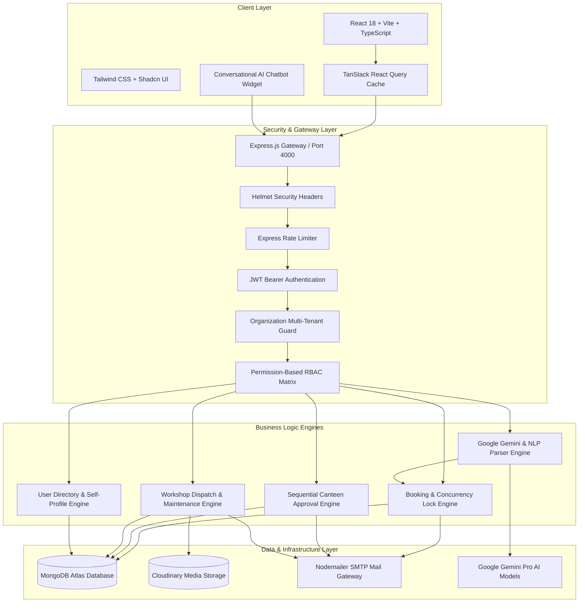
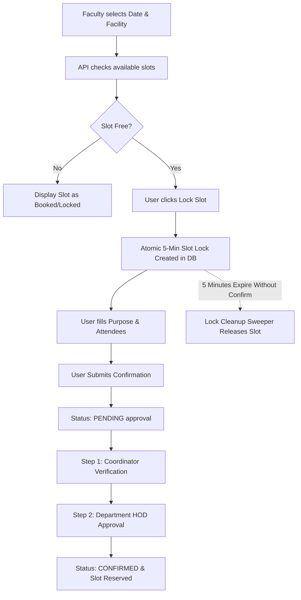
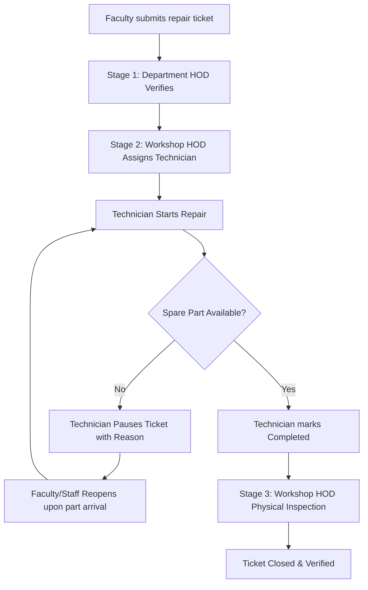
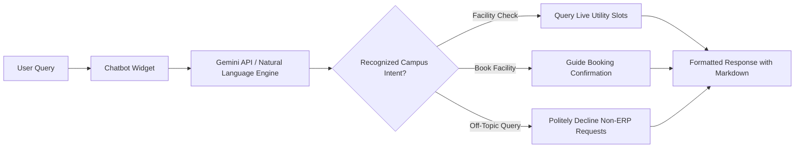

# 🎓 College Utility Management — Campus Operations & Resource ERP

[](https://reactjs.org/)
[](https://vitejs.dev/)
[](https://www.typescriptlang.org/)
[](https://nodejs.org/)
[](https://expressjs.com/)
[](https://www.mongodb.com/)
[](https://tailwindcss.com/)
[](https://ai.google.dev/)
[](https://opensource.org/licenses/MIT)

**College Utility Management** is an enterprise-grade, multi-tenant digital campus operations and resource management ERP platform. It modernizes and unifies **facility reservations, departmental canteen requisitions, campus maintenance repair ticketing, role-based access control (RBAC), and conversational AI assistance** into a single seamless web portal.

The application eliminates paper forms, manual registers, and fragmented phone calls, providing automated multi-level approval workflows, atomic race-condition prevention, and role-aware dashboards for educational institutions.

---

## 📑 Table of Contents

- [What This Project Is & Problems It Solves](#-what-this-project-is--problems-it-solves)
- [System Architecture](#-system-architecture)
- [Role-Based Access Hierarchy (11 Roles)](#-role-based-access-hierarchy-11-roles)
- [Core Functional Modules & How It Works](#-core-functional-modules--how-it-works)
  - [1. Facility & Resource Booking with 5-Minute Slot Locks](#1-facility--resource-booking-with-5-minute-slot-locks)
  - [2. Canteen Requisitions & Food Approval Pipeline](#2-canteen-requisitions--food-approval-pipeline)
  - [3. Workshop & Maintenance Ticketing System](#3-workshop--maintenance-ticketing-system)
  - [4. Conversational AI Assistant (Google Gemini)](#4-conversational-ai-assistant-google-gemini)
  - [5. Multi-Tenancy & Self-Service Profile Management](#5-multi-tenancy--self-service-profile-management)
- [Technology Stack](#-technology-stack)
- [Repository Structure](#-repository-structure)
- [Step-by-Step Installation & Running Guide](#-step-by-step-installation--running-guide)
  - [Prerequisites](#prerequisites)
  - [1. Clone Repository](#1-clone-repository)
  - [2. Backend Setup](#2-backend-setup)
  - [3. Frontend Setup](#3-frontend-setup)
  - [4. Root Workspace Scripts](#4-root-workspace-scripts)
- [Environment Variables Configuration](#-environment-variables-configuration)
- [Testing & Quality Assurance](#-testing--quality-assurance)
- [API Architecture & Endpoints](#-api-architecture--endpoints)
- [Core Development Team](#-core-development-team)
- [License](#-license)

---

## 💡 What This Project Is & Problems It Solves

Educational institutions operate dozens of shared physical and administrative assets: auditoriums, seminar halls, computer labs, projectors, hospitality kitchens, and maintenance repair teams. Traditional manual workflows lead to:
- **Double Bookings & Slot Clashing**: Multiple departments reserving the same seminar hall for the same time window.
- **Uncontrolled Food Expenses**: Event refreshments and meals ordered without departmental budget verification or administrative sign-offs.
- **Delayed Classroom Repairs**: Unrecorded breakdown complaints about projectors, electrical switchboards, and air conditioners resulting in disrupted lectures.
- **Administrative Overhead**: Endless paper slips, lost approval requests, and lack of real-time operational status visibility.

### Key Solutions Provided

1. **Atomic Concurrency Locks**: When a user selects a time slot, the engine locks the slot with an atomic 5-minute reservation lock, preventing race conditions and double bookings.
2. **Sequential Multi-Tier Approval Ladders**: Requisitions and reservations pass through strict, role-enforced approval steps with automated email notifications.
3. **End-to-End Maintenance Dispatch**: Campus equipment repair tickets transition from faculty reporting $\rightarrow$ HOD approval $\rightarrow$ workshop technician assignment $\rightarrow$ work progress/pause reasons $\rightarrow$ physical inspection sign-off.
4. **Conversational AI Booking**: Users can type queries like *"Book Seminar Hall Alpha tomorrow afternoon for a guest lecture"* and the Google Gemini AI handles slot discovery and guided confirmation.
5. **Multi-Tenant Architecture**: Supports multiple independent colleges, universities, or institutions on a single software deployment with strict database scoping.

---

## 🏛️ System Architecture



---

## 👥 Role-Based Access Hierarchy (11 Roles)

The platform enforces a synchronized Role-Based Access Control matrix (`config/permissions.js` $\leftrightarrow$ `rbac/permissions.ts`):

| Role | Scope | Key Capabilities & Duties |
| :--- | :--- | :--- |
| **`super_admin`** | Platform | Global platform administration, college onboarding, cross-organization audits, chatbot usage analytics. |
| **`org_admin`** | Organization | Institution settings, user roster management, category and facility creation, utility permissions. |
| **`coordinator`** | Utility/Lab | Manages assigned facilities, creates custom schedule slots, verifies initial booking requests. |
| **`hod`** | Department | Department head; approves faculty hall bookings, verifies department canteen requisitions, approves classroom repair tickets. |
| **`registrar`** | Institution | Verifies institutional budgets, validates financial feasibility of requisitions. |
| **`director`** | Institution | Top executive administrative sign-off for institution-wide requisitions and events. |
| **`faculty`** | Department | Books rooms and seminar halls, reports broken campus equipment, edits personal profile. |
| **`assistant`** | Department | Creates and submits departmental food and beverage canteen orders for official events. |
| **`workshop_hod`** | Workshop | Central maintenance head; reviews approved repair tickets, assigns technicians, performs final work verification. |
| **`worker`** | Technician | Maintenance technician; updates ticket progress (`ONGOING`, `PAUSED` with reason, `COMPLETED`). |
| **`canteen_owner`** | Kitchen | Manages menu prices, accepts approved food requisitions, tracks kitchen cooking, dispatches peon deliveries. |

---

## ⚙️ Core Functional Modules & How It Works

### 1. Facility & Resource Booking with 5-Minute Slot Locks



- **Race Condition Prevention**: Prevents two simultaneous users from booking the same hall. When a slot is clicked, the server places a temporary lock expiring in 5 minutes (`lockExpiresAt`).
- **Autonomous Sweeper**: A background lock sweeper runs every 60 seconds on the server, safely pruning abandoned locks and making slots available again.
- **Custom Approval Flows**: Each utility category supports customized approval steps (e.g. Coordinator only, Coordinator + HOD, or Coordinator + HOD + Registrar).

---

### 2. Canteen Requisitions & Food Approval Pipeline

```mermaid
flowchart LR
    A[Assistant Adds Menu Items] --> B[Submit Requisition]
    B --> C[Stage 1: HOD Budget Approval]
    C --> D[Stage 2: Registrar Verification]
    D --> E[Stage 3: Director Sign-Off]
    E --> F[Kitchen Queue: Canteen Owner]
    F --> G[Chef marks PREPARED]
    G --> H[Assign Peon Delivery Name & Phone]
    H --> I[Mark HANDED_OVER & Completed]
```



- **Itemized Requisition Cart**: Requesters select items (food, tea, snacks, meals) from an active catalog with real-time INR cost calculation.
- **Sequential Multi-Tier Approvals**: Prevents unauthorized college expense claims by chaining approvals from Department HOD $\rightarrow$ Registrar $\rightarrow$ Director.
- **Kitchen Logistics**: Kitchen personnel receive approved tickets with dietary quantities, prepare items, and record delivery personnel credentials upon dispatch.

---

### 3. Workshop & Maintenance Ticketing System



- **Evidence Uploads**: Faulty hardware, damaged projectors, or electrical hazards can be documented with images uploaded directly to Cloudinary.
- **Pause & Resume Workflow**: Technicians can place tickets in `PAUSED` state with mandatory reason logging (e.g., waiting for manufacturer spare parts), keeping requesters updated.
- **Ticket Chat Sidebar**: A dedicated slide-out discussion panel enables real-time comments between requesters, HODs, and technicians directly on the ticket.

---

### 4. Conversational AI Assistant (Google Gemini)



- **Context-Aware Intent Resolution**: Understands queries in natural language, resolving fuzzy dates (*"tomorrow afternoon"*, *"next Monday at 10 AM"*).
- **ERP Boundary Enforcement**: Rejects non-campus requests (such as generic coding questions or trivia) to maintain professional institutional relevance.
- **Resilient Fallback**: Automatically falls back to an internal rule-based keyword matcher when external Gemini API credentials are absent.

---

### 5. Multi-Tenancy & Self-Service Profile Management

- **Tenant Isolation**: Every database collection enforces an `organizationId` partition, allowing multi-campus universities to run on a shared infrastructure.
- **Self-Service Updates**: Users can update their name, telephone, and email. Updating email addresses immediately invalidates existing JWT sessions to enforce security.

---

## 🛠️ Technology Stack

| Layer | Technologies | Purpose |
| :--- | :--- | :--- |
| **Frontend Framework** | React 18.3, TypeScript 5.8, Vite 7.x | High-performance single page application with strict typing |
| **Styling & UI Components** | Tailwind CSS 3.4, Shadcn UI, Radix UI | Modern, accessible component design system |
| **Client-Side State** | TanStack React Query 5.x, React Context | Server state synchronization, caching, and optimistic updates |
| **Routing & Navigation** | React Router DOM 6.30 | Client-side routing with role-protected route guards |
| **Visualizations** | Recharts 2.15 | Operational charts, utilization trends, and admin metrics |
| **Backend Runtime** | Node.js 18+, Express.js 4.19 | Modular, asynchronous REST API service |
| **Database & Modeling** | MongoDB Atlas, Mongoose 8.6 | Document database with schema validation and indexing |
| **Authentication & RBAC** | JSON Web Tokens (jsonwebtoken), bcryptjs | Stateless authorization and secure password hashing |
| **Security Suite** | Helmet, CORS, Express Rate Limit | HTTP header protection, cross-origin guards, and rate limiting |
| **AI Integration** | Google Gemini Pro API | Conversational natural language interface |
| **Media & Assets** | Cloudinary SDK | Cloud storage for maintenance ticket photos and facility images |
| **Email Transport** | Nodemailer | Transactional email dispatches for approvals and resets |

---

## 🗂️ Repository Structure

```text
college-utility-management/
├── package.json                    # Root monorepo workspace configuration & shortcuts
├── vercel.json                     # Vercel deployment routing configuration
├── .gitignore                      # Git ignore rules for node_modules, build, and .env
├── docs/
│   └── CONVENTIONS.md              # Coding, API, and architectural conventions
│
├── backend/                        # Backend REST API service (Node.js + Express)
│   ├── package.json
│   ├── .env.example                # Sample backend environment configuration
│   ├── src/
│   │   ├── app.js                  # Express application factory & middleware stack
│   │   ├── server.js               # HTTP listener, DB connect & lock-cleanup sweeper
│   │   ├── booking/                # Booking engine, slot algorithms & validation
│   │   ├── chatbot/                # Conversational AI tools, intent parsers, and prompts
│   │   ├── config/                 # Database connection, env loader, and RBAC matrix
│   │   ├── controllers/            # Thin HTTP request/response handlers
│   │   ├── middleware/             # Auth JWT, RBAC guards, sanitizer, error handling
│   │   ├── models/                 # Mongoose schemas (User, Booking, Utility, Ticket, etc.)
│   │   ├── routes/                 # Express feature routers (auth, orgs, bookings, etc.)
│   │   ├── services/               # Core business logic implementations
│   │   ├── utils/                  # Email service, timeslot math, logger, http errors
│   │   └── workflows/              # State machine rules for maintenance & requisitions
│   └── scripts/
│       └── seed.js                 # Initial database seeding script
│
└── frontend/                       # Frontend application (React 18 + Vite + TypeScript)
    ├── package.json
    ├── vite.config.ts
    ├── tsconfig.json
    ├── tailwind.config.ts
    ├── components.json             # Shadcn UI configuration
    ├── public/                     # Static assets, favicons, site manifest
    └── src/
        ├── main.tsx                # Client entrypoint
        ├── App.tsx                 # Root router and global providers
        ├── assets/                 # SVGs, college logos, and visual assets
        ├── components/             # Reusable UI elements, modals, navbars, sidebars
        ├── hooks/                  # Custom hooks (toast, mobile detection, SEO)
        ├── lib/                    # API client (Axios), auth tokens, workflow helpers
        ├── pages/                  # Routed views (Dashboard, Booking, Canteen, etc.)
        ├── rbac/                   # Frontend role permission definitions
        ├── types/                  # TypeScript interface definitions (utility, user, etc.)
        └── utils/                  # Timeslot helpers and utility formatters
```

---

## 🚀 Step-by-Step Installation & Running Guide

### Prerequisites

Ensure you have installed on your local machine:
- **Node.js**: v18.0.0 or higher ([Download Node.js](https://nodejs.org/))
- **npm**: v9.0.0 or higher
- **MongoDB**: A free cloud cluster on [MongoDB Atlas](https://www.mongodb.com/cloud/atlas) or a local MongoDB service (`mongodb://localhost:27017/college_erp`).
- **Git**: Installed and configured.

---

### 1. Clone Repository

```bash
git clone https://github.com/chaiitanya-r/college-utility-management.git
cd college-utility-management
```

Verify your git remote configuration:
```bash
git remote -v
# Output should point to: https://github.com/chaiitanya-r/college-utility-management.git
```

---

### 2. Backend Setup

Open a terminal and navigate to the `backend` directory:

```bash
cd backend

# Create your environment file from the template
cp .env.example .env

# Install backend dependencies
npm install
```

Configure your `.env` file with your MongoDB Atlas connection string (see [Environment Variables Configuration](#-environment-variables-configuration) below).

Start the backend in development watch mode:
```bash
npm run dev
```

The backend API will start on:
```text
http://localhost:4000
```
You should see:
```text
MongoDB connected
Backend API listening on port 4000
```

---

### 3. Frontend Setup

Open a second terminal window and navigate to the `frontend` directory:

```bash
cd frontend

# Create your environment file from the template
cp .env.example .env

# Install frontend dependencies
npm install

# Start Vite development server
npm run dev
```

The frontend application will start on:
```text
http://localhost:5173
```
Open [http://localhost:5173](http://localhost:5173) in your browser.

---

### 4. Root Workspace Scripts

From the root project directory, you can also use these convenient shortcuts:

```bash
# Start backend in dev mode
npm run dev:backend

# Start frontend in dev mode
npm run dev:frontend

# Build frontend for production
npm run build:frontend

# Seed database with initial organization and accounts
npm run seed:backend
```

---

## 🔐 Environment Variables Configuration

### Backend (`backend/.env`)

```env
# Server Port & Mode
PORT=4000
NODE_ENV=development

# Database Connection (MongoDB Atlas or Local)
MONGODB_URI=mongodb+srv://<username>:<password>@cluster0.example.mongodb.net/college_erp?retryWrites=true&w=majority

# JWT Signing Secret (must be a strong secret in production)
JWT_SECRET=your_super_secret_jwt_key_here
JWT_EXPIRES_IN=7d

# CORS Allowed Origin
FRONTEND_URL=http://localhost:5173

# Superadmin Seed Credentials
SUPERADMIN_EMAIL=superadmin@campus.edu
SUPERADMIN_PASSWORD=SuperSecurePassword123!

# AI Chatbot (Optional - falls back to internal rules if omitted)
GEMINI_API_KEY=AIzaSyYourGeminiApiKeyHere

# SMTP Email Dispatch (Optional - emails logged to console if omitted)
SMTP_HOST=smtp.gmail.com
SMTP_PORT=587
SMTP_SECURE=false
SMTP_USER=your_email@gmail.com
SMTP_PASSWORD=your_app_specific_password
EMAIL_FROM=noreply@campus.edu
EMAIL_FROM_NAME=College Utility Management

# Cloudinary Media Storage (Optional for ticket image attachments)
CLOUDINARY_NAME=your_cloudinary_cloud_name
CLOUDINARY_API_KEY=your_cloudinary_api_key
CLOUDINARY_SECRET_KEY=your_cloudinary_secret_key
```

### Frontend (`frontend/.env`)

```env
# Backend API Base URL
VITE_API_URL=http://localhost:4000/api
VITE_API_PORT=4000
VITE_BACKEND_PORT=4000
NODE_ENV=development
```

---

## 🧪 Verification & Build
  
### 1. TypeScript Strict Type Safety
Verifies full frontend compile-time type safety with zero errors:
```bash
cd frontend
npx tsc -p tsconfig.app.json --noEmit
```

### 2. Production Build Verification
Generates optimized production bundle for frontend deployment:
```bash
cd frontend
npm run build
```

### 3. Database Seeding (Initial Setup)
Seeds default organization, academic departments, and standard staff roles:
```bash
cd backend
npm run seed
```

---

## 🔌 API Architecture & Endpoints

| Area | Prefix / Endpoint | Methods | Description |
| :--- | :--- | :--- | :--- |
| **Authentication** | `/api/auth/login` | `POST` | User login, returns JWT token & role |
| | `/api/auth/forgot-password` | `POST` | Request password reset OTP |
| | `/api/auth/verify-otp` | `POST` | Validate password reset OTP |
| | `/api/auth/reset-password` | `POST` | Set new password with verified OTP |
| **Organizations** | `/api/organizations` | `GET`, `POST` | List institutions or onboard new college |
| **Users** | `/api/orgs/:orgId/users` | `GET`, `POST` | User directory management (Admin) |
| | `/api/orgs/:orgId/users/me/profile` | `PUT` | Self-service profile update (Name, Phone, Email) |
| **Categories** | `/api/orgs/:orgId/categories` | `GET`, `POST`, `PUT` | Manage facility categories & approval steps |
| **Utilities** | `/api/orgs/:orgId/utilities` | `GET`, `POST`, `PUT` | Manage campus halls, rooms, and labs |
| **Bookings** | `/api/orgs/:orgId/bookings/availability` | `GET` | Query available/booked timeslots |
| | `/api/orgs/:orgId/bookings/lock` | `POST` | Create 5-minute atomic lock on slot |
| | `/api/orgs/:orgId/bookings/confirm` | `POST` | Confirm temporary lock into pending booking |
| | `/api/orgs/:orgId/bookings/:id/status` | `PATCH` | Approve/Reject booking in workflow |
| **Canteen** | `/api/orgs/:orgId/canteen-menu` | `GET`, `POST`, `PUT` | Canteen items & price catalog |
| | `/api/orgs/:orgId/requisitions` | `GET`, `POST` | List and submit food orders (Assistant) |
| | `/api/orgs/:orgId/requisitions/:id/status` | `PATCH` | Approve/Reject requisition (HOD/Reg/Dir) |
| | `/api/orgs/:orgId/requisitions/:id/prepare` | `PATCH` | Mark food as prepared in kitchen |
| | `/api/orgs/:orgId/requisitions/:id/handover` | `PATCH` | Dispatch order with peon delivery details |
| **Maintenance** | `/api/orgs/:orgId/maintenance` | `GET`, `POST` | List & report maintenance tickets |
| | `/api/orgs/:orgId/maintenance/:id/actions` | `POST` | Workflow actions (approve, assign, pause, reopen, complete) |
| | `/api/orgs/:orgId/maintenance/:id/comments`| `POST` | Add discussion chat comment to ticket |
| **AI Chatbot** | `/api/chat` | `POST` | Send natural-language query to Gemini assistant |
| **Health** | `/api/health`, `/api/ready` | `GET` | Health status and database connectivity checks |

---

## 👥 Core Development Team

This project was engineered by:

| Developer | Role | Major Contributions |
| :--- | :--- | :--- |
| **Chaitanya Retawade** | **Full-Stack Lead** | Core Facility & Utility Booking engine, temporary concurrency slot locking, multi-tier approvals, backend API architecture, and frontend integration. |
| **Samadhan Mane** | **Project Architect** | Foundational ERP architecture, Google Gemini conversational AI assistant integration, and system roadmap. |
| **Krishna Gadhave** | **Backend Engineer** | End-to-end Canteen & Food Requisition pipeline, multi-level hierarchical approval workflows, and kitchen order logistics. |
| **Vivek Borade** | **Full-Stack Engineer** | Campus Maintenance & Repair ticketing lifecycle, technician dispatch system, and responsive UI components. |

- **Official GitHub Repository**: [https://github.com/chaiitanya-r/college-utility-management.git](https://github.com/chaiitanya-r/college-utility-management.git)
- **Contact & Inquiries**: [chaitanya.retawade08@gmail.com](mailto:chaitanya.retawade08@gmail.com)

---

## 📄 License

This project is licensed under the **MIT License** — feel free to use, modify, and distribute it for educational institutions, colleges, and university operations.
